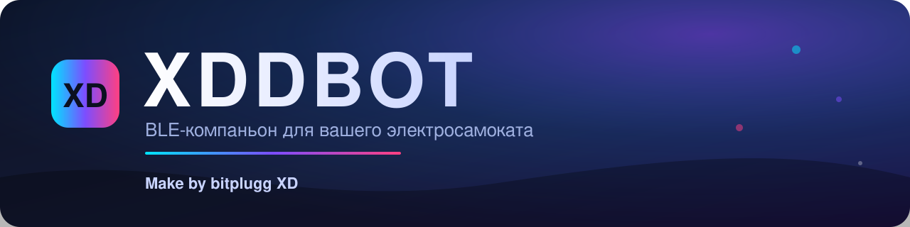
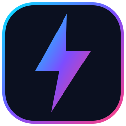

<div align="center">



<br>

[](https://github.com/bitplugg/XDDbot/actions/workflows/android.yml)
[](https://github.com/bitplugg/XDDbot/releases)
[-3ddc84?logo=android&logoColor=white)](#сборка)
[](https://kotlinlang.org)
[](https://developer.android.com/jetpack/compose)
[](https://github.com/bitplugg/XDDbot/wiki)

**XDDBOT** — клиент-компаньон для **собственного** электросамоката по BLE.
Подключается по вашему ключу, показывает обмен, умеет базовые команды и демо-режим без железа.

</div>

> [!IMPORTANT]
> Только для устройств, которыми вы владеете или на которые у вас есть явное разрешение.
> В приложении **нет** подбора/генерации ключей, перебора чужих кодов и обхода замков.
> Очередь кодов листается **вручную**: приложение не перебирает варианты автоматически.

---

## Содержание

- [Возможности](#возможности)
- [Скриншоты](#скриншоты)
- [Сборка](#сборка)
- [CI / Release](#ci--release)
- [Протокол](#протокол)
- [Структура проекта](#структура-проекта)
- [Телеметрия](#телеметрия)
- [Документация](#документация)

---

## Возможности

| Раздел | Что умеет |
| --- | --- |
| 🔐 **Ключи** | Ввод кода/ключа вручную, импорт из текстового файла, профили с `deviceType`, шифрованное хранение (EncryptedSharedPreferences) |
| 🔎 **BLE** | Скан, подключение по Nordic UART (NUS), MTU, чанковые записи, notify + CCCD, проверка CRC кадров |
| 🛴 **Команды** | Открыть / Закрыть, Сигнал (Find car) — плюс полная таблица опкодов в `protocol/Opcode.kt` |
| 📜 **Журнал** | Живой лог обмена TX/RX/INFO/ERROR с подсветкой |
| 🎭 **Демо-режим** | Полный UI без реального железа (для эмулятора и обзора) |
| 🎨 **UI** | Kotlin, Jetpack Compose, Material 3 / Material You, тёмная и светлая темы |

## Скриншоты

> Скриншоты появятся после первого публичного релиза. Пока интерфейс можно
> посмотреть в демо-режиме (`Настройки → Демо-режим`).

## Сборка

```bash
./gradlew assembleDebug               # debug APK
./gradlew testDebugUnitTest           # unit-тесты
./gradlew lint                        # линт
./gradlew connectedDebugAndroidTest   # instrumented (нужен эмулятор/устройство)
```

Release-подпись задаётся переменными окружения (или `keystore.properties`, не коммитится):

```text
ANDROID_KEYSTORE_PATH
ANDROID_KEYSTORE_PASSWORD
ANDROID_KEY_ALIAS
ANDROID_KEY_PASSWORD
```

## CI / Release

`.github/workflows/android.yml`:

- **build** — lint → unit → `assembleDebug` / `assembleRelease`, артефакты APK;
- **instrumented** — эмулятор API 30 (`reactivecircus/android-emulator-runner`);
- **worker** — тесты Cloudflare Worker (`node --test`);
- **pages** — сайт и статический API из `docs/` на GitHub Pages при пуше в `main`.

По тегу `v*` APK публикуются в **GitHub Releases**.

### Секреты репозитория

| Секрет | Назначение |
| --- | --- |
| `ANDROID_KEYSTORE_BASE64` | release keystore, `base64 -w0` |
| `ANDROID_KEYSTORE_PASSWORD` | пароль хранилища |
| `ANDROID_KEY_ALIAS` | алиас ключа |
| `ANDROID_KEY_PASSWORD` | пароль ключа |

## Протокол

Кадр:

```text
A3 A4 len (rand+50) (devType^rand) (cmd^rand) payload^rand crc8
```

- `len` — длина payload (после XOR), полный кадр `7 + len` байт;
- `deviceType` и `cmd` маскируются байтом `rand`;
- **CRC8** — MAXIM/DALLAS, проверочное значение `0xA1`;
- **CRC16** — MODBUS (poly `0xA001`, init `0xFFFF`), проверочное `0x4B37`;
- ключ/код передаётся как **сырой текст в UTF-8** в опкоде `1` (рукопожатие `deviceType = 0`,
  реальный тип приходит в ответе).

Реализация: `xdbot.bitplugg.ru.protocol`. BLE-транспорт: Nordic UART Service (NUS).

## Структура проекта

```text
app/src/main/java/xdbot/bitplugg/ru/
├── protocol/     # кадры, CRC8/CRC16, опкоды, hex
├── ble/          # NUS-клиент, скан/подключение, модели
├── data/         # ключи, импорт файлов, телеметрия
├── ui/           # Compose-экраны (scan, device, settings, logs)
└── XddbotApp.kt  # Application и синглтоны
worker/           # Cloudflare Worker (телеметрия, opt-in)
docs/             # GitHub Pages: сайт, баннеры, статический API
```

## Телеметрия

Полностью **opt-in** и по умолчанию **выключена**. Отправляются только имя события,
версия приложения, Android SDK и тип устройства самоката. **Никаких** ключей, кодов,
BLE-адресов и имён. Включается в `Настройки → Анонимная телеметрия`, сборщик —
Cloudflare Worker в [`worker/`](worker/) (по умолчанию не задан).

## Документация

Полное руководство — в [**Wiki**](https://github.com/bitplugg/XDDbot/wiki):
протокол, сборка и релиз, приватность, FAQ.

---

<div align="center">



**Make by bitplugg XD**

</div>
